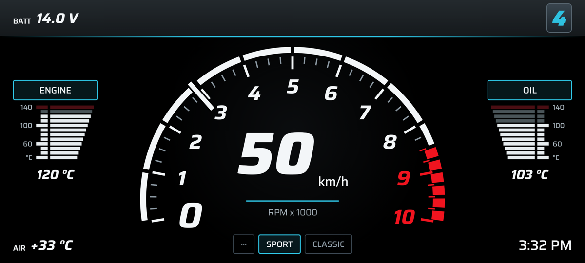
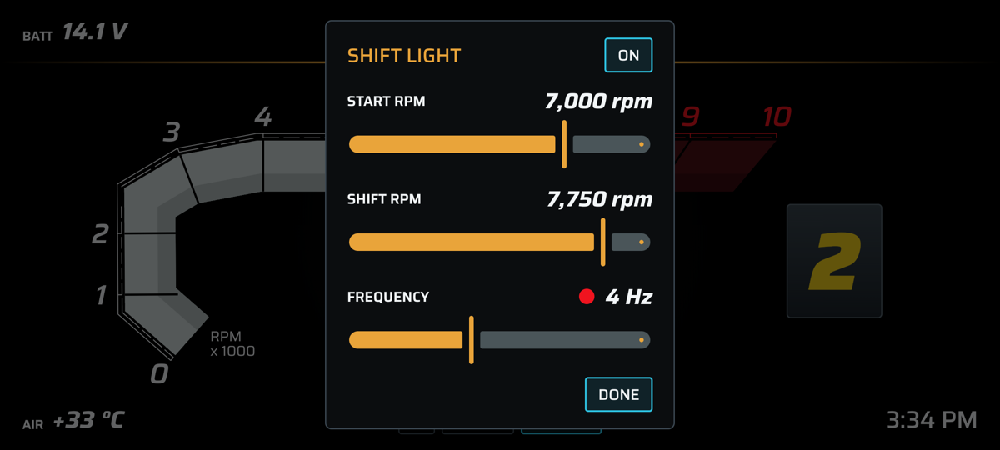
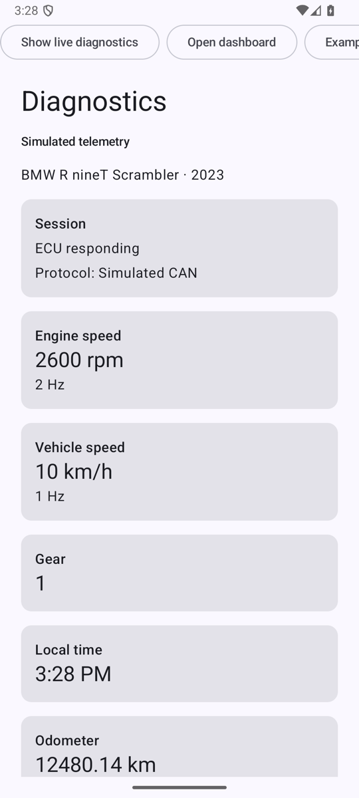

# R9T OBD2 Dashboard

**Turn an Android phone into a second instrument cluster for a BMW R nineT.**

A cheap Bluetooth ELM327 adapter plugged into the bike's diagnostic port is all it needs. The app reads the engine computer directly and shows RPM, speed, temperatures and battery voltage on a full-screen, landscape dashboard inspired by the bike's own TFT display, with a configurable shift light on top.



> Built for and tested on my 2023 R nineT Scrambler. Personal project, not affiliated with or endorsed by BMW.

## Highlights

- **TFT-style display.** *Sport* is a round tachometer with the speed in its center. The display tabs at the bottom stay ready for more styles; the app remembers your choice.
- **Engine vitals at a glance.** Engine and oil temperature, battery voltage and intake air temperature, refreshed about every 10 seconds; they change slowly, so RPM and speed keep the bus.
- **Shift light.** From the start RPM the screen edges glow amber; from the shift RPM they flash red. Start RPM, shift RPM and flashing frequency are adjustable.
- **Needle feel.** The tachometer needle's spring (damping and stiffness) can be tuned by hand; **Default** restores the feel confirmed on the bike.
- **Ride mode.** While the dashboard is open the screen stays on and the system bars hide away.
- **RPM and speed come first.** About 15 readings a second on the reference bike, asked for together in one request; slower readings are fitted in between, so the needle never waits for a temperature.
- **Smooth drawing.** Each display keeps its scale, ticks and numerals in a cached GPU layer and redraws only the needle or lit segments, at a steady 60 Hz.
- **Safe by design.** The app only ever sends read requests, checked against an allowlist before anything leaves the phone, and stops asking as soon as the ignition goes off.
- **Connection lamp.** Beside the display tabs, a connector glyph shows the adapter link at a glance: green and joined while the bike answers, flashing amber while connecting (faster when a link was lost), red when it failed. Tap it to reconnect to the last adapter in one touch, choose another, or disconnect.
- **Recovers on its own.** If the Bluetooth link drops mid-ride, the dashboard says it is reconnecting and the app retries by itself until readings resume.
- **Honest about what it knows.** A reading that has not arrived shows as `--`, never as a made-up zero. Gear and total distance only appear when the data source provides them.
- **Built-in diagnostics.** A step-by-step view of the Bluetooth link, the adapter and the engine computer, with every command and reply logged and exportable.

## Screenshots

| Shift light settings | Diagnostics |
| --- | --- |
|  |  |

*Screenshots come from the built-in simulation, which also shows gear and total distance. On the reference bike those two stay hidden, because its engine computer does not report them through standard OBD-II.*

## Try it without a motorcycle

The debug build includes a simulator and a capture player, so you can explore everything on an emulator or any phone.

1. Open the project in Android Studio, sync Gradle and run the `app` configuration with the **debug** variant. You need Android SDK Platform 37 and a device or emulator on Android 14 or newer.
2. The app opens on the dashboard and tries the bike first. Open the gear menu, tap **Show simulation** and turn the phone sideways. It plays a 75-second excerpt recorded on the reference bike, in a loop, with the ECU's real timing, so the dashboard behaves as it does on the bike.
3. Use the tabs at the bottom to switch displays, and the **···** menu for the display's settings (shift light and needle). The gear menu beside it holds the app's own: other sources, diagnostics or **Back to the bike**.

**Open capture** plays any session log exported from the phone instead, and **Synthetic data** switches to a generated 36-second ride that never sits still: blips into the shift light's red zone, hard pulls through four gears, throttle on and off and downshift blips, answered the way the bike's ECU answers (a new value about every 200 ms, repeats in between, Mode 01 resolution), to test the needle over its whole range. Replays never touch Bluetooth.

## Use it on the bike

You need an ELM327 adapter that speaks **Bluetooth Classic** (the common "ELM327 Mini" kind). If your bike has BMW's round diagnostic socket instead of a standard OBD-II one, add a round-to-OBD-II adapter cable.

1. Plug the adapter in, switch the ignition on and pair the adapter in Android's Bluetooth settings. Close any other OBD-II app that might be connected to it.
2. Open the app. The first time, allow **Nearby devices** and choose the adapter.
3. The dashboard is the main screen and connects on its own. Every later start connects straight to the same adapter; **Choose adapter** in the gear menu picks another one.

If something goes wrong, **Diagnostics** in the gear menu tells you which step failed: Bluetooth, the adapter, or the engine computer. *Unable to connect* or *no data* from the engine computer usually means the ignition is off.

When you switch the ignition off, the session notices within two seconds, stops sending requests and shows the failure; tap the connection lamp to reconnect after the next start.

**Park with the adapter unplugged.** The diagnostic socket stays powered with the ignition off, so a plugged-in adapter keeps drawing from the battery even when the app is closed. Unplug it if the bike will stand for more than a day or two. Every session log records the battery voltage the adapter sees (`ATRV`).

**Session logs.** Every connection is recorded privately on the phone. Use **Session logs** to export one as a JSON Lines file, for troubleshooting or to replay it in the debug build. Logging can be turned off in **Settings**. The log is written in the background, so requests no longer wait for it.

## How it works

The app talks to the adapter over a direct Bluetooth serial (RFCOMM) link and uses standard OBD-II requests:

| Reading | Request | Refresh |
| --- | --- | --- |
| Engine RPM and vehicle speed | `010C0D1` (both in one exchange, single reply) | Every cycle, as fast as the adapter answers |
| Engine and oil temperature, battery voltage, intake air | `0105`, `015C`, `0142`, `010F` | One reading every 2 s, in rotation: each about every 10 s |
| Other advertised sensors | See the [telemetry inventory](docs/OBD_TELEMETRY.md) | One slot in four |

On the reference bike (ISO 15765-4 CAN, 11-bit, 500 kbit/s) each exchange takes about 55 ms, which gives about 15 RPM and speed readings a second; the day before, asking for them separately, it was 6.4 and 2.4. Asking for both in one request, and telling the adapter to expect a single reply, did most of that. The measurements are in [the field test notes](docs/FIELD_TEST_2026-11-25.md).

### Safety

Polling standard OBD-II data cannot harm the engine computer: the requests only read values the ECU must provide, one at a time, using under 1 % of the bus. To keep it that way:

- **Read requests only.** An allowlist lets through the adapter's own `AT` settings and Mode 01 "current data" requests, nothing else. Clearing trouble codes, test control, diagnostic sessions, security access, writes or programming cannot be sent, even by mistake.
- **No traffic to a sleeping bike.** Two seconds without RPM or speed end the session, and it does not retry, so requests never keep the bike's control units awake.

[Connection options and safety](docs/CONNECTION_OPTIONS.md) covers the reasoning, the faster alternatives (listening to the CAN bus, STN-based adapters) and their trade-offs.

The code follows Clean Architecture, with pure Kotlin logic kept apart from Android so it can be unit tested:

| Package | What lives there |
| --- | --- |
| `diagnostics/application` | The session contract shared by the live, simulated and replay sources: states, readings and errors |
| `diagnostics/data` | The ELM327 session, split into handshake, polling loop, polling schedule, reconnect policy and the command allowlist; the Bluetooth transport; PID decoding; session logs |
| `diagnostics/ui` | Diagnostics screen and its ViewModel |
| `dashboard` | The Sport display as a `GaugeStyle` strategy drawn in layers by `LayeredGauge`, their pure geometry, the connection lamp, the shift light and the shared TFT styling |
| `src/debug` | The simulator, the capture player and the demo entry point |

Built with Kotlin, Jetpack Compose, Material 3, coroutines and AndroidX ViewModel.

## Tests

```sh
./gradlew :app:testDebugUnitTest          # JVM unit tests
./gradlew :app:connectedDebugAndroidTest  # instrumented tests, on an emulator
```

Unit tests cover PID decoding, the polling schedule and its priority rules, reconnection, the command allowlist, the ignition-off stop, the session log format and the display geometry. A scripted ELM327 adapter lets them run a complete session, including timeouts, dropped links and incomplete replies, without hardware. Instrumented tests check capture replay and that the displays redraw only their moving layer.

Two benchmarks measure a real phone: `DashboardFrameBenchmark` (drawing only) and `DashboardPipelineBenchmark` (session, view model and dashboard over a fake adapter, with logging on and off). On your own phone, install the app and test APKs and run them with `adb shell am instrument`, as described in the field test notes: `connectedAndroidTest` uninstalls the app afterwards, and its session logs with it.

## Roadmap

- Measure the latest connection changes on the bike: readings per second with logging on and off, and the ignition-off stop.
- Try a short, supervised listen on the CAN bus to see whether RPM, speed and gear are broadcast at the diagnostic socket.
- Fix the release build's R8 configuration, which crashes at startup (the `profile` build type is the stopgap).
- Estimate the gear from the RPM to speed ratio with a riding capture, or read it from the CAN bus.
- Find a reliable source for total distance.

The full plan, with acceptance criteria for each step, is in [ROADMAP.md](ROADMAP.md).

## Author

[Felipe Garcia](https://github.com/FelipeGarcia911) · Android development, diagnostic data modeling and UI architecture.
