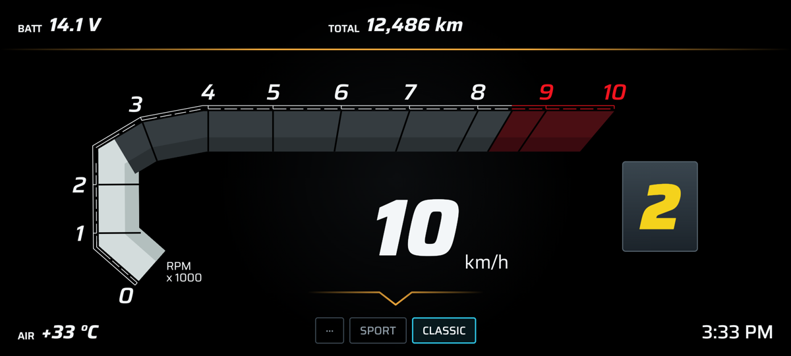
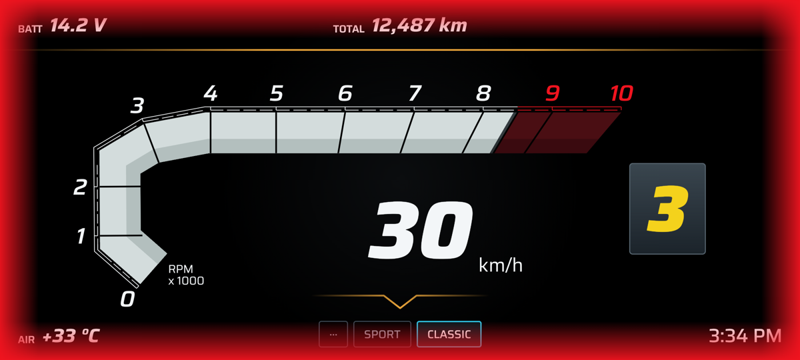

# R9T OBD2 Dashboard

**Turn an Android phone into a second instrument cluster for a BMW R nineT.**

A cheap Bluetooth ELM327 adapter plugged into the bike's diagnostic port is all it needs. The app reads the engine computer directly and shows RPM, speed, temperatures and battery voltage on a full-screen, landscape dashboard inspired by the bike's own TFT display, with a configurable shift light on top.


> Built for and tested on my 2023 R nineT Scrambler. Personal project, not affiliated with or endorsed by BMW.

## Highlights

- **Two displays, one tap apart.** *Sport* is a round tachometer with the speed in its center; *Classic* is a bar tachometer that climbs the left edge and runs across the top. Switch between them from the bottom of the screen; the app remembers your choice.
- **Engine vitals at a glance.** Engine and oil temperature, battery voltage and intake air temperature, read from the bike every few seconds.
- **Shift light.** From the start RPM the screen edges glow amber; from the shift RPM they flash red. Start RPM, shift RPM and flashing frequency are adjustable.
- **Ride mode.** While the dashboard is open the screen stays on and the system bars hide away.
- **RPM and speed come first.** The app asks for them as fast as the adapter answers and fits the slower readings in between, so the needle never waits for a temperature.
- **Recovers on its own.** If the Bluetooth link drops mid-ride, the dashboard says it is reconnecting and the app retries by itself until readings resume.
- **Honest about what it knows.** A reading that has not arrived shows as `--`, never as a made-up zero. Gear and total distance only appear when the data source provides them.
- **Built-in diagnostics.** A step-by-step view of the Bluetooth link, the adapter and the engine computer, with every command and reply logged and exportable.

## Screenshots

| Classic display | Shift light at the limit |
| --- | --- |
|  |  |

| Shift light settings | Diagnostics |
| --- | --- |
|  |  |

*Screenshots come from the built-in simulation, which also shows gear and total distance. On the reference bike those two stay hidden, because its engine computer does not report them through standard OBD-II.*

## Try it without a motorcycle

The debug build includes a simulator and a capture player, so you can explore everything on an emulator or any phone.

1. Open the project in Android Studio, sync Gradle and run the `app` configuration with the **debug** variant. You need Android SDK Platform 37 and a device or emulator on Android 14 or newer.
2. Tap **Show simulation**, then **Open dashboard**, and turn the phone sideways.
3. Use the tabs at the bottom to switch displays, and the **···** menu for the shift light settings or to go back to diagnostics.

To replay a real ride instead, tap **Example capture** (bundled with the app) or **Open capture** to choose a session log exported from the phone, then **Play capture**. Replays run with the original timing and never touch Bluetooth.

## Use it on the bike

You need an ELM327 adapter that speaks **Bluetooth Classic** (the common "ELM327 Mini" kind). If your bike has BMW's round diagnostic socket instead of a standard OBD-II one, add a round-to-OBD-II adapter cable.

1. Plug the adapter in, switch the ignition on and pair the adapter in Android's Bluetooth settings. Close any other OBD-II app that might be connected to it.
2. Open the app, tap **Connect**, allow **Nearby devices** and choose the adapter.
3. Wait for the session to reach *ECU responding*, then tap **Open dashboard**.

If something goes wrong, the diagnostics screen tells you which step failed: Bluetooth, the adapter, or the engine computer. *Unable to connect* or *no data* from the engine computer usually means the ignition is off.

**Session logs.** Every connection is recorded privately on the phone. Use **Session logs** to export one as a JSON Lines file, for troubleshooting or to replay it in the debug build. Logging can be turned off in **Settings**.

## How it works

The app talks to the adapter over a direct Bluetooth serial (RFCOMM) link and uses standard OBD-II requests:

| Reading | Request | Refresh |
| --- | --- | --- |
| Engine RPM and vehicle speed | `010C0D` (both in one exchange) | Every cycle, as fast as the adapter answers |
| Engine and oil temperature, battery voltage, intake air | `0105`, `015C`, `0142`, `010F` | One reading per second, in rotation |
| Other advertised sensors | See the [telemetry inventory](docs/OBD_TELEMETRY.md) | One slot in four |

On the reference bike (ISO 15765-4 CAN, 11-bit, 500 kbit/s) each exchange takes about 75 ms. Asking for RPM and speed together halves the requests needed for the two readings that matter most while riding.

The code follows Clean Architecture, with pure Kotlin logic kept apart from Android so it can be unit tested:

| Package | What lives there |
| --- | --- |
| `diagnostics/application` | The session contract shared by the live, simulated and replay sources: states, readings and errors |
| `diagnostics/data` | The ELM327 session, split into handshake, polling loop, polling schedule and reconnect policy; the Bluetooth transport; PID decoding; session logs |
| `diagnostics/ui` | Diagnostics screen and its ViewModel |
| `dashboard` | The Sport and Classic displays, their pure geometry, the shift light and the shared TFT styling |
| `src/debug` | The simulator, the capture player and the demo entry point |

Built with Kotlin, Jetpack Compose, Material 3, coroutines and AndroidX ViewModel.

## Tests

```sh
./gradlew :app:testDebugUnitTest          # JVM unit tests
./gradlew :app:connectedDebugAndroidTest  # capture replay, on a device or emulator
```

Unit tests cover PID decoding, the polling schedule and its priority rules, reconnection, the session log format and the display geometry. A scripted ELM327 adapter lets them run a complete session, including timeouts, dropped links and incomplete replies, without hardware.

## Roadmap

- Validate RPM and speed refresh rates with a riding capture, now that both are read in one request.
- Estimate the gear from the RPM to speed ratio, or find a read-only source for it on the bike's CAN bus.
- Find a reliable source for total distance.

The full plan, with acceptance criteria for each step, is in [ROADMAP.md](ROADMAP.md).

## Author

[Felipe Garcia](https://github.com/FelipeGarcia911) · Android development, diagnostic data modeling and UI architecture.
